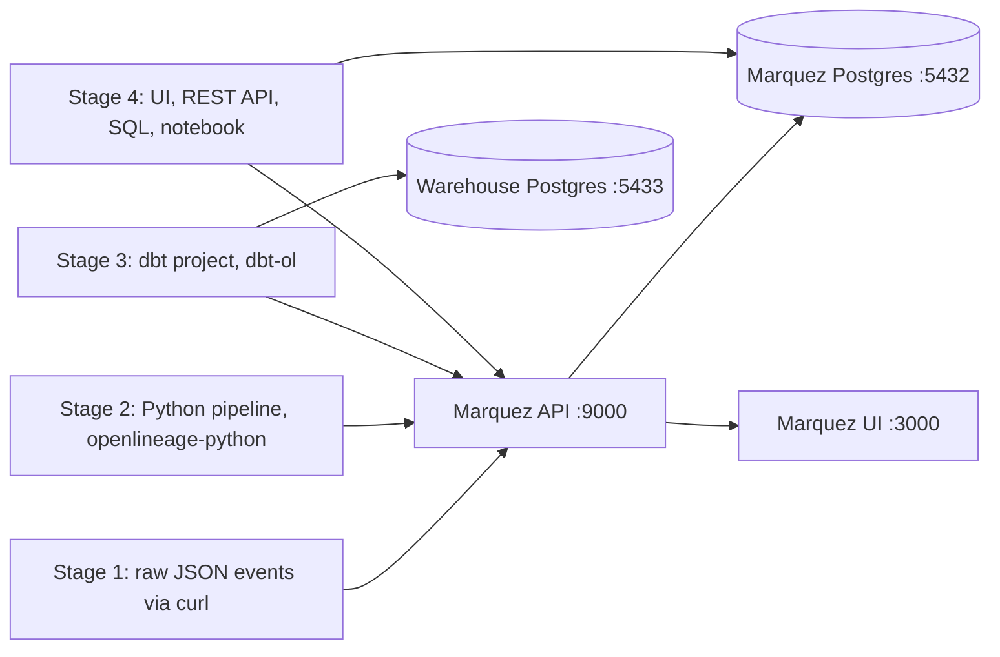

# OpenLineage + Marquez learning POC

A small, layered playground for learning [OpenLineage](https://openlineage.io) (the event spec) and
[Marquez](https://marquezproject.ai) (a reference backend that stores and visualises those events).
Each stage adds one concept, and all stages use the same tiny e-commerce domain
(`orders` -> cleaned orders -> `daily revenue`), so their graphs connect in Marquez.



| Stage | Folder | You learn |
| --- | --- | --- |
| 0 | `docker-compose.yml`, `marquez/` | running Marquez (API, UI, Postgres) plus a warehouse Postgres |
| 1 | `stage1_raw_events/` | the event model: run, job, datasets, event types, facets |
| 2 | `stage2_python_pipeline/` | emitting events from code, facets built from real data, parent runs |
| 3 | `stage3_dbt/` | what a real integration (`dbt-ol`) emits and how it compares to hand-written events |
| 4 | `stage4_explore/` | UI, REST API, SQL on the Marquez DB, impact/root-cause analysis with networkx |

## Prerequisites

* Docker Desktop (or another Docker engine with `docker compose`)
* [uv](https://docs.astral.sh/uv/) - creates the Python 3.12 virtualenv with `uv sync --python 3.12`
* `curl`, `uuidgen` (preinstalled on macOS)

Ports used on the host: `3000` UI, `9000` API (container 5000 - host 5000 is taken by the macOS AirPlay
Receiver), `9001` admin, `5432` Marquez Postgres (`marquez`/`marquez`), `5433` warehouse Postgres
(`warehouse`/`warehouse`). The Marquez images are amd64-only and run under emulation on Apple Silicon.

> If `docker` is not found in your shell, Docker Desktop ships its CLI in
> `/Applications/Docker.app/Contents/Resources/bin` - add it to `PATH` (the helper script does this itself).

## Quick start

```bash
uv sync --python 3.12
./demo.sh            # starts the stack and runs every stage once (add --reset for a clean slate)
open http://localhost:3000
```

Or go stage by stage as described below. Run all commands from the repository root.

## Stage 0: infrastructure

```bash
docker compose up -d
curl localhost:9000/api/v1/namespaces     # API is up
open http://localhost:3000                # UI
docker compose down -v                    # stop and wipe all data
```

Tip: Marquez ships a demo dataset (`./docker/up.sh --seed` in the
[Marquez repo](https://github.com/MarquezProject/marquez)) if you want to see a busy UI first. Wipe it
with `docker compose down -v` before continuing here.

## Stage 1: hand-written events

```bash
./stage1_raw_events/send.sh                 # ingest -> stg -> daily revenue (fails)
./stage1_raw_events/send.sh --schema-change # ingest again with an extra column
./stage1_raw_events/send.sh --rerun         # fix: build_daily_revenue succeeds
./stage1_raw_events/send.sh --dry-run       # print the rendered JSON instead of sending
```

The files in `stage1_raw_events/events/` are plain OpenLineage `RunEvent`s (placeholders `__NOW__` and
`__RUN_*__` are filled in by the script). Facets are introduced step by step:

| Files | What is new |
| --- | --- |
| `01`, `02` | the bare minimum: `eventType`, `eventTime`, `run.runId`, `job`, `inputs`, `outputs`, `producer`, `schemaURL` |
| `03`, `04` | `sql` job facet, `schema`, `documentation` and `columnLineage` dataset facets, `outputStatistics`, `parent` run facet |
| `05`, `06` | a `FAIL` event with an `errorMessage` run facet |
| `07` | schema change: a lone `COMPLETE` event (no `START`) with a new column |
| `08`, `09`, `10`, `11` | a second run of the failed job (`START` + `COMPLETE`) and `COMPLETE`/`FAIL` events for the parent run |

Look for in the UI (http://localhost:3000): the namespace switcher (top right), the job/dataset graph
(click a dataset - lineage), run history of `build_daily_revenue` (FAILED, then COMPLETED after
`--rerun`), dataset versions of `warehouse.public.raw_orders` (the schema change), and the
column-level lineage tab on `stg_orders`.

Things worth noticing:

* Events are independent. Marquez stitches them together by `runId`; a lone `COMPLETE` works but has no
  start time or duration.
* **Parent runs rename jobs.** Because jobs `03`-`06`, `08`-`09` carry a `parent` facet, Marquez stores them as
  `daily_pipeline.build_stg_orders` etc. A job without the facet would be a different job.
* Marquez creates a new dataset version for every event that lists an output. Events `01`/`03`/`05` list outputs
  on `START` without a schema, which creates empty versions (stage 2 avoids this by only reporting outputs on `COMPLETE`/`FAIL`).

## Stage 2: Python pipeline

```bash
uv run python stage2_python_pipeline/pipeline.py                       # happy path
uv run python stage2_python_pipeline/pipeline.py --schema-change       # adds coupon_code -> new dataset versions
uv run python stage2_python_pipeline/pipeline.py --fail-at clean_orders
uv run python stage2_python_pipeline/pipeline.py --transport console   # print events, nothing is sent
uv run python stage2_python_pipeline/pipeline.py --transport file      # append to ./events.jsonl
```

`pipeline.py` runs three pandas jobs under one `daily_pipeline` parent run
(`data/source/orders_export.csv` -> `extract_orders` -> `clean_orders` -> `build_daily_revenue`). The
`JobRun` context manager emits `START` on entry and `COMPLETE`/`FAIL` on exit. Facets are computed from the
real DataFrames: `schema`, `dataQualityMetrics` (row counts, null counts, min/max), `outputStatistics`,
`columnLineage` (with transformation types), `documentation`, `jobType` and `errorMessage`.

Design note: `START` events list only inputs; `COMPLETE` events list outputs with their facets. `FAIL` lists the
outputs again (bare) so a failed job keeps its edges in the lineage graph - the price is an empty dataset version
for the failed run (the notebook and `queries.sql` skip versions without a schema).

The client is configured by [`openlineage.yml`](openlineage.yml) (HTTP transport to Marquez). Use
`--transport console|file` to look at the events without Marquez; reading them is the best way to learn the spec.

## Stage 3: dbt

```bash
./stage3_dbt/run_dbt_ol.sh          # plain seed/run/docs generate, then dbt-ol seed, run, test
./stage3_dbt/run_dbt_ol.sh run test # only specific commands, each through dbt-ol
```

`dbt-ol` wraps the normal dbt CLI and converts `manifest.json`, `run_results.json` and `catalog.json` into events
after the command finishes (namespace from `OPENLINEAGE_NAMESPACE=poc_dbt`, endpoint from `OPENLINEAGE_URL`).
The project builds `stg_orders`, `stg_customers`, `fct_daily_revenue` and `dim_customer_ltv` in the warehouse
Postgres, with `not_null`/`unique` tests. Compare with what you wrote by hand:

* column lineage is derived from the model SQL automatically (`columnLineage` facet)
* tests show up as `dataQualityAssertions` facets and as `*.test` jobs
* every `dbt-ol` invocation is one parent run (`dbt-run-shop`) with a child run per model/test
* dataset names (`warehouse.public.stg_orders` in namespace `postgres://localhost:5433`) are the same as in the
  stage 1 events, so the graphs **connect** across stages

Gotchas this stage teaches:

* `dbt-ol` ignores `ref()`-ed seeds, so the raw tables are declared as dbt **sources** (`models/sources.yml`);
  otherwise `stg_*` would have no upstream dataset.
* Column names/types come from `target/catalog.json` (`dbt docs generate`). Without it Marquez stores untyped columns.
* Marquez identifies a column by `(name, type)`. Stage 1 uses Postgres-style types (`bigint`, `text`, ...) exactly like
  dbt reports them; with `BIGINT` vs `bigint` you get duplicate columns and the column-lineage API can fail with HTTP 500.
  Keep naming and typing consistent across producers.

## Stage 4: making sense of the data

* **UI** - http://localhost:3000: lineage graph, column lineage, run history and durations, dataset version diffs, search,
  tags (`./demo.sh` tags `stg_customers.email` as `PII`).
* **REST API** - [`stage4_explore/lineage_api.http`](stage4_explore/lineage_api.http) (VS Code/Cursor "REST Client"
  extension, or copy the URLs into `curl`): lineage graph, column lineage, runs, versions, search, raw events, tags.
  [OpenAPI docs](https://marquezproject.github.io/marquez/openapi.html).
* **SQL** - [`stage4_explore/queries.sql`](stage4_explore/queries.sql), 13 annotated queries on the Marquez database:

  ```bash
  docker exec -i marquez-db psql -U marquez -d marquez < stage4_explore/queries.sql
  ```

  Failed runs with error messages, run durations, child runs per parent, current job inputs/outputs, dataset versions,
  schema changes, column-lineage edges, dbt assertions and dead-end datasets. `lineage_events` holds every raw event as `jsonb`.
* **Notebook** - [`stage4_explore/explore.ipynb`](stage4_explore/explore.ipynb): loads the lineage graph into
  `networkx` and answers impact analysis ("what is downstream of `raw_orders`?"), root cause ("which failed job makes
  `fct_daily_revenue` stale?"), column provenance, schema drift, data-quality facets and the raw event stream.

  ```bash
  uv run jupyter lab stage4_explore/explore.ipynb
  ```

## Project layout

```
docker-compose.yml        Marquez API/UI/DB + warehouse Postgres
marquez/marquez.yml       Marquez server config (migrates the DB on start)
openlineage.yml           OpenLineage client config used by stage 2
pyproject.toml            uv project (openlineage-python, dbt-postgres, openlineage-dbt, pandas, networkx, jupyter)
demo.sh                   start the stack and run all stages (--reset for a clean slate)
stage1_raw_events/        events/*.json + send.sh
stage2_python_pipeline/   pipeline.py (data is generated into data/, git-ignored)
stage3_dbt/               dbt project, profiles.yml, run_dbt_ol.sh
stage4_explore/           queries.sql, lineage_api.http, explore.ipynb
```

## Where to go next

* Add a PySpark job with the `openlineage-spark` listener (Java is installed) or an Airflow DAG with
  `apache-airflow-providers-openlineage`, and check whether its dataset names connect to the existing graph.
* Write a custom facet (own JSON schema) and query it from `queries.sql`.
* Try other transports (`kafka`, `composite`) and `filters` in `openlineage.yml`.
